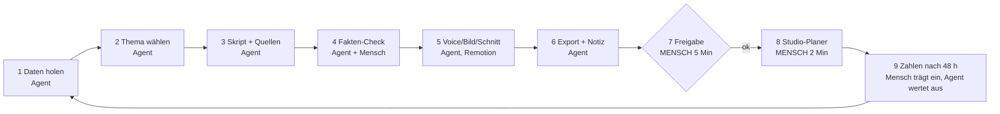

# Agenten-Pipeline: ein Agent liefert die fertigen Videos

> [!summary] Kurz
> **Ja, fast alles kann ein Agent.** Die Pipeline plant Themen aus Zahlen, schreibt, prüft Fakten, baut das Video und legt Datei + Caption fertig ab. **Zwei Dinge bleiben beim Menschen:** (1) kurze Freigabe pro Video (Ziel ca. 2 Min, siehe Abschnitt 8), (2) Hochladen über TikTok Studio / YouTube Studio. Volle Automatik ohne Mensch = Risiko für Creator Rewards und das YouTube-Partnerprogramm.
> Kosten: **0 € extra** (nur Claude-Abo + Gratis-Werkzeuge). Zugehörig: [[00_Hauptziel]] · [[01_Strategie]] · [[Auto-Upload]] · [[Roadmap]]

## 1. Die Pipeline

| # | Schritt | Wer | Wie / Werkzeug | Kosten |
|---|---|---|---|---|
| 1 | Trend- + Performance-Daten | Agent ([[Trend-Scout]], [[Performance-Analyst]]) | Siehe Abschnitt 2 | 0 € |
| 2 | Thema/Format wählen | Agent ([[Format-Zerleger]]) | Bewertung: Outlier-Faktor, Nachstellbarkeit, Nischen-Fit, **eigene** 48-h-Zahlen höher gewichtet. Pro Woche 1 Format-Test aus [[01_Strategie]] (A/B/C) | 0 € |
| 3 | Skript-Entwurf | Agent ([[Creator]]) | Eigene Erzählung, Hook-Typ und Länge **bewusst variieren** (Vorgabe pro Video) | Abo |
| 4 | Fakten-Check mit Quellen | Agent sucht, **Mensch prüft** | 2 unabhängige Quellen pro Kerntatsache, Links in die Notiz. Agent markiert „unsicher". | Abo |
| 5 | Voice, Bilder, Schnitt | Agent baut | Remotion + Skill `cartoon-3d-short`; Stimme: Gratis-TTS oder echte Stimme (Test laut [[01_Strategie]]); Bilder: gemeinfrei/eigene Cartoon-Szenen; Musik nur lizenzfrei | 0 € |
| 6 | Export + Notiz | Agent | `media/<datum>-<slug>.mp4` (1080×1920, 65–90 s, ohne Wasserzeichen) + Notiz nach [[Video-Idee]]: Caption, 3–5 Hashtags, Quellen, Rohskript, Geld-Check vorausgefüllt | 0 € |
| 7 | **Freigabe** | **Mensch** | Siehe Abschnitt 4 | 5 Min |
| 8 | Planen/Hochladen | **Mensch** | TikTok Studio + YouTube Studio, KI-Schalter selbst setzen ([[Auto-Upload]]) | 2 Min |
| 9 | Auswertung | Mensch trägt Zahlen ein (`views_48h`, `retention_%`), Agent wertet aus | TikTok Studio / YouTube Studio manuell kopieren | 3 Min/Woche |

## 2. Datenquellen (nur offiziell/öffentlich, keine Logins für Bots)

| Quelle | Was | Wie der Agent drankommt | Stand |
|---|---|---|---|
| [TikTok Creative Center](https://ads.tiktok.com/help/article/creative-center) | Trend-Hashtags, Songs, Creators, Videos nach Region/Branche; gratis, öffentlich ([Hilfe](https://ads.tiktok.com/help/article/how-to-use-trends)) | Mensch kopiert 1×/Woche (5 Min) Text/Screenshot in `10_Wissen/Trends/`. Kein Scraping. | Update-Takt der Listen **unklar** (nur Blogs, z. B. [Metricool](https://metricool.com/tiktok-creative-center/)) |
| TikTok Studio (eigenes Konto) | Wiedergabedauer, Retention, Shares, Traffic-Quellen | Mensch trägt in Video-Notiz ein (siehe Schritt 9) | offiziell |
| YouTube Studio (eigener Kanal) | Retention, Shares, Abos je Short | Mensch trägt ein | offiziell |
| YouTube Data API (Gratis-Kontingent) | öffentliche Zahlen zu Videos/Kanälen der Nische (nur lesen) | Skill `trend-scout`, Roadmap Phase 3 | Kontingent siehe [Google-Doku](https://developers.google.com/youtube/v3/docs/videos/insert) (Quota nicht von uns geprüft → **unklar**) |
| Google Trends, Reddit (öffentliche Seiten) | Themen-Nachfrage | Skill `trend-scout` | nur Ideen-Signal, **nie Text übernehmen** |

**Ehrlich:** Die *eigenen* Zahlen sind das beste Signal, brauchen aber erst ~30 Videos. Davor ist die Auswahl ein Schätzen aus öffentlichen Trends. Eine Scraping-Lösung für TikTok ist **nicht** vorgesehen (Nutzungsbedingungen, Konto-Risiko).

## 3. Wo volle Automatik mit den Geld-Regeln kollidiert

### 3a. TikTok Creator Rewards („Originalinhalt")
- Offizielle Linie: Inhalte sollen originell sein, „unique to the creator" ([Zusammenfassung Toptal](https://www.toptal.com/creator/post/how-to-join-the-tiktok-creator-rewards-program), Zweitquelle). Videos > 1 Min, persönliches Konto ([Auszahlungen](Auszahlungen.md)).
- **Widersprüchlich:** Eine Vendor-Quelle sagt, voll KI-generierte Videos seien ausgeschlossen, KI-unterstützter Schnitt/B-Roll erlaubt ([Storrito](https://storrito.com/resources/what-tiktoks-ai-monetization-restrictions-signal-for-creator-income/)). Eine andere sagt, KI-Videos würden bezahlt, wenn gekennzeichnet ([Lilach Bullock](https://www.lilachbullock.com/ai-generated-videos-monetised-tiktok/)). **Keine davon ist offiziell. Eine feste Schwelle für „zu viel KI" ist nicht veröffentlicht → unklar.**
- Folge: Ein Video, das **nur** per Knopfdruck aus KI entsteht, ist das größte Risiko. Mensch muss erkennbar Ideen, Skript-Änderung, Auswahl und Schnitt beitragen (siehe 4). Das ist auch unser Beleg, falls TikTok nachfragt.

### 3b. YouTube „inauthentic content"
- Juli 2026 klargestellt: Nicht verboten ist KI, sondern **massenhaft gleiche/wiederholte Videos** (KI, CGI, Schablonen), unbefriedigende/verstörende Inhalte und KI-Personen bei heiklen Themen (Finanzen, Recht, Medizin) ([TechCrunch](https://techcrunch.com/2026/07/20/youtube-clarifies-policies-around-ai-slop-and-upsetting-videos/), [Tubefilter](https://www.tubefilter.com/2026/07/13/youtube-inauthentic-content-monetization-policy-update/), [eWeek](https://www.eweek.com/news/youtube-responds-to-ai-concerns/)). Datum je nach Quelle 15./16. Juli.
- Betroffen kann der **ganze Kanal** sein; es gibt Berichte über Fehlflags bei Originalinhalt (Quellen oben). Genauer YouTube-Originaltext von mir **nicht** gelesen → unklar.
- Genau hier liegt das Risiko eines Agenten: **Fließband mit gleichem Aufbau**. Gegenmittel: pro Video **Variations-Vorgabe** (Hook-Typ, Länge, Szenenstil, Erzählperspektive), nie zweimal hintereinander gleich; lieber 1–2 gute Videos/Tag als 3 Schablonen.

### 3c. KI-Label und C2PA
- TikTok verlangt Kennzeichnung bei realistischen KI-Inhalten, setzt bei C2PA-Daten in der Datei **automatisch** ein „KI-generiert"-Label ([TikTok Transparenz](https://www.tiktok.com/transparency/en/supporting-responsible-transparent-ai-generated-content/), [Hilfe](https://support.tiktok.com/en/using-tiktok/creating-videos/ai-generated-content)). Seit Nov. 2025 testet TikTok unsichtbare Wasserzeichen ([Newsroom](https://newsroom.tiktok.com/more-ways-to-spot-shape-and-understand-ai-generated-content?lang=en-GB)).
- Ob das Label die **Reichweite/Auszahlung** senkt: **nicht belegt, unklar.** Für YouTube sagt die Hilfe: Label begrenzt Reichweite/Monetarisierung nicht ([YouTube](https://support.google.com/youtube/answer/14328491)).
- Regel: Der **Mensch setzt den KI-Schalter** beim Planen (Agent trägt „KI-Schalter: ja/nein + Grund" in die Notiz ein). Der Agent prüft die Datei auf C2PA-Daten (z. B. `exiftool`/`c2patool`, gratis) und schreibt das Ergebnis in die Notiz. Cartoon-Stil mit eigenen Zeichnungen ist deutlich unproblematischer als fotorealistische KI-Bilder – **bei Cartoon-Stil bleiben**.

## 4. Was voll automatisch laufen darf – und was nicht

| Schritt | Voll automatisch? | Begründung |
|---|---|---|
| Daten holen, auswerten, Themenvorschläge | **Ja** | kein Veröffentlichen, nur intern |
| Themenwahl | **Ja, mit Vorgaben** (Format-Rotation, Sperrliste, Nische) | Mensch sieht Auswahl in der Freigabe |
| Skript-Entwurf + Quellensuche | **Ja** | Entwurf, noch nichts live |
| Fakten-Check | **Halb:** Agent sammelt, Mensch bestätigt Kerntatsachen | Falsche „wahre Geschichte" = Vertrauens- und Strike-Risiko |
| Voice, Bilder, Schnitt, Export | **Ja** | Werkzeugarbeit |
| Caption/Hashtags/Notiz | **Ja** (Entwurf) | Mensch darf ändern |
| **Freigabe** | **Nein – Mensch, ca. 5 Min** | Beleg für „eigene Arbeit", fängt Fehler/Schablone/Verstörendes |
| **KI-Schalter + Upload** | **Nein – Mensch** | [[Auto-Upload]]: kein Bot-Login, nur Studio-Planer |
| Zahlen nach 48 h | Mensch kopiert, Agent wertet aus | kein Zugriff per Bot |

### Die 5-Minuten-Freigabe (Checkliste im Video-Idee-Geld-Check)
1. **Video einmal ganz ansehen** (65–90 s) – Ton, Untertitel, nichts Verstörendes/Politisches.
2. **Kerntatsachen gegen die Quellen** in der Notiz prüfen (1–2 Klicks).
3. **Eigener Beitrag:** mindestens eine Änderung am Skript (Satz, Hook oder Schluss-Frage) – „Mensch hat es geformt".
4. **Anders als die letzten 5 Videos?** (Hook, Aufbau, Optik) – sonst zurück an den Agenten.
5. KI-Schalter-Entscheidung + Häkchen im Geld-Check; dann `status: live` nach dem Planen.

## 5. Aufwand, Kosten, Risiko, Abo-Verbrauch

| | Wert |
|---|---|
| Menschlicher Aufwand | ~5 Min Freigabe + 2 Min Planen je Video, + 5 Min Wochenpflege (Creative-Center-Kopie) + 3 Min Zahlen = bei 10 Videos/Woche ca. **1,5–2 Std/Woche** (Schätzung) |
| Kosten | 0 €. Ausnahme: Gratis-TTS/Remotion-Lizenz prüfen – **Remotion hat eine Lizenz-Regel für Firmen** ([[remotion-license]]-Skill nutzen), für uns **unklar**, vor Start prüfen |
| Abo-Verbrauch | **Unklar, nicht gemessen.** Grobe Annahme: Skript + Faktencheck je Video moderat; Remotion-Bau (Code erzeugen/anpassen) ist der größte Brocken. Mitigation: ein **fester Remotion-Baukasten**, Agent füllt nur Daten (Skript, Bilder, Timings) statt jedes Mal Code zu schreiben. Messen laut Roadmap Phase 3 („Verbrauch prüfen") |
| Hauptrisiko | Schablonen-Muster (YouTube), „zu viel KI" (TikTok, unklar), falsche Fakten, Konto-Sperre bei Bot-Upload (vermieden) |
| Rest-Risiko | Nicht null. Eine Person darf nie „nur durchwinken" – Freigabe ernst nehmen |

## 6. Aufbau in Stufen (nach Roadmap)
1. **Jetzt (Phase 2):** Pipeline von Hand mit Claude: Schritte 3–6 testen, Remotion-Baukasten aus `cartoon-3d-short` ableiten. Ziel: 10 Videos.
2. **Phase 3:** `trend-scout` + [[Morgen-Briefing]] automatisch (geplante Aufgabe). Agent liefert täglich 1–2 fertige Skriptentwürfe.
3. **Phase 4 (ab ~30 Videos):** eigene Zahlen steuern die Themenwahl; Vergleichstests aus [[01_Strategie]] (Stimme, Aufbau) laufen mit.
4. **Phase 5:** Server, evtl. n8n – aber **Upload bleibt Studio**.

## 7. Dauer-Prüffragen
1. **Potenzial:** Die Pipeline bringt **keine zusätzlichen Views von selbst**. Sie bringt Menge, Konstanz und datengetriebene Wahl. Views kommen aus Hook, Watchtime, Shares ([[01_Strategie]]). Datenlage zu „welche Formate zahlen": Tool-Blogs, Schätzungen. **Unklar**, ob datengetriebene Auswahl besser ist als gutes Bauchgefühl, bevor ~30 Videos eigene Zahlen liefern. Vorteil: wenig Menschenzeit → mehr Videos/Tests möglich.
2. **Sicherheit:** Mit Freigabe + Variation + Quellen + Studio-Upload = **kontrollierbar, nicht null**. Ohne Freigabe (voll automatisch) = **nein, nicht empfohlen** (TikTok „Originalinhalt" unklar/streng laut Vendor-Quellen; YouTube Schablonen-Regel gilt für den ganzen Kanal). Offizielle Primärtexte von TikTok zur KI-Schwelle für Creator Rewards **nicht gefunden → unklar**, im Konto nachlesen.

## Offene Punkte (A)
- [ ] Creator-Rewards-Regeln im echten TikTok-Konto nach „KI/Originalität" durchlesen und hier ergänzen
- [ ] Remotion-Lizenz für uns klären
- [ ] Abo-Verbrauch pro Video messen (nach 5 Videos)
- [ ] Variations-Katalog (Hook-Typen, Stile, Längen) für den Agenten anlegen
- [ ] Gratis-TTS wählen und gegen Menschenstimme testen

## 8. Update 26.11.2026: Mensch-Anteil verkleinern (Nachfrage von A)

Ziel: weniger Handarbeit. Ehrlich: **1 Min pro Video ist nicht sicher machbar**, ca. 2 Min schon. Der Rest ist Rechenzeit des Agenten.

### 8a. Zahlen auslesen statt eintragen
| Plattform | Auslesen durch Agent? | Wie | Stand |
|---|---|---|---|
| **YouTube** | **Ja, offiziell** | YouTube Analytics API, nur lesen, eigener Kanal (`channel==MINE`), liefert Views, Ø Wiedergabedauer, Ø Wiedergabe in %, Shares ([Doku](https://developers.google.com/youtube/analytics/sample-requests)). Einmalige Anmeldung (OAuth) durch den Kanalinhaber, danach läuft es allein. | Scope und Token-Laufzeit bei nicht geprüfter App **unklar**, beim Einrichten testen |
| **TikTok** | **Teilweise** | Display API (`video.list`) liefert `view_count`, `share_count` für eigene öffentliche Videos ([Doku](https://developers.tiktok.com/docs/en/tiktok-api-v1-video-list)). **Keine Wiedergabedauer/Retention** (nicht in den Feldern gefunden). Braucht eigene App + Freigabe durch TikTok → **unklar, ob schnell genehmigt**; Research-API ist nur für Forscher. | Retention nur im TikTok Studio sichtbar |
| TikTok Studio Retention | **Nein automatisch** | Kein Login-Bot (Sperrrisiko, siehe [[Auto-Upload]]). Ersatz: **1× pro Woche 1 Min** Screenshot/Export der Studio-Übersicht in `media/zahlen/` ablegen; der Agent liest das Bild/die Datei und trägt alles in die Notizen ein. CSV-Export im Studio: **nicht bestätigt**. | unklar |

→ Mensch-Aufwand Zahlen: **von 3 Min auf ca. 1 Min pro Woche**, YouTube ganz ohne.

### 8b. Trends: der Agent sucht selbst
- **Ohne TikTok-Login, ohne Handarbeit:** YouTube Data API (Shorts-Trends der Nische), Google Trends, Websuche. Das ist offiziell/öffentlich und läuft täglich allein ([[Trend-Scout]]).
- **TikTok Creative Center:** Test heute: **nicht erreichbar in diesem Cloud-Container** (Host `ads.tiktok.com` vom Netzwerk blockiert, Fehler DNS). Ob die Seite ohne Login lesbare Zahlen liefert, ist **ungetestet**. Ob automatisches Lesen gegen die TikTok-Nutzungsbedingungen verstößt, ist **unklar**. Es gibt keine offizielle API für diese Trendlisten (nicht gefunden).
- **Plan:** (1) YouTube + Google Trends sofort automatisch. (2) Creative Center im späteren Server-Betrieb (Phase 5) **einmal testen**, nur öffentliche Seiten, ein Abruf pro Tag, kein Login. Geht es nicht, bleibt es bei 5 Min/Woche von Hand **oder wird gestrichen** – die eigenen Zahlen sind ohnehin das bessere Signal.

### 8c. Freigabe von 5 auf ca. 2 Min
Ein **Prüf-Agent** läuft vor der Freigabe und liefert einen Kurzbericht:
- Fakten gegen Quellen: grün/gelb/rot, nur Gelbes muss der Mensch lesen.
- Ähnlichkeit zu den letzten 5 Videos (Hook, Aufbau, Optik): Zahl + Ampel.
- Geld-Check automatisch vorausgefüllt, C2PA-Prüfung, Länge, Untertitel-Position, Musik-Lizenz.
- **Hook-Wahl:** Der Agent bietet 3 Hooks an, der Mensch klickt 1 an (10 Sek). Das ist die „eigene Entscheidung" pro Video.

Mensch macht dann: Video auf 1,5× ansehen (~1 Min), Bericht lesen (~30 Sek), Hook wählen, Freigeben. **Ziel ca. 2 Min.**
- Planen im Studio: ca. 1–2 Min pro Video, aber **gebündelt 1× pro Woche** (Sammelplanung).
- Warum nicht auf 1 Min / ganz weg: Das ist **meine vorsichtige Wahl, keine Plattform-Regel**. Weder TikTok noch YouTube schreiben „Mensch prüft jedes Video" vor. Verlangt wird Originalität und keine Massenware. Die Freigabe ist unser Beleg und unser Fehlerfilter. Wenn nach 30 Videos die Prüfberichte fast nie etwas finden, kann man auf Stichproben (jedes 2.–3. Video) umstellen. Bis dahin: alle.

### Neue Mensch-Bilanz
| Was | Vorher | Jetzt (Ziel) |
|---|---|---|
| Freigabe pro Video | 5 Min | ca. 2 Min |
| Planen pro Video | 2 Min | 1–2 Min, 1× pro Woche gebündelt |
| Zahlen eintragen | 3 Min/Woche | ca. 1 Min/Woche (TikTok-Screenshot), YouTube 0 |
| Trends kopieren | 5 Min/Woche | 0 (YouTube/Trends-Agent), Creative Center: Test offen |
| **10 Videos/Woche** | ca. 1,5–2 Std | **ca. 40–50 Min** (Schätzung) |
