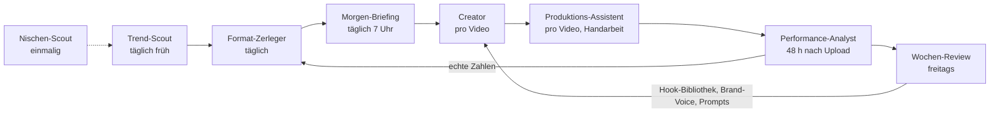

# Roadmap – Faceless Short-Form (TikTok & YouTube Shorts)

> [!info] So benutzt ihr diese Notiz
> Von oben nach unten abarbeiten. Jede Phase hat ein **Ziel**, einen **Meilenstein** und eine **Checkliste**.
> Häkchen setzen, sobald etwas erledigt ist. Wer zuständig ist, steht in Klammern: **(A)** oder **(B)**.
> Die tägliche Übersicht „wer macht gerade was" ist das [[Kanban]]-Board.

## Rollen – wer ist wofür zuständig?

| | **Person A – „Recherche & Technik"** | **Person B – „Kreativ & Produktion"** |
|---|---|---|
| Schwerpunkt | Trends finden, Zahlen auswerten, Technik/Server | Skripte, Hooks, Schnitt, Upload, Brand-Voice |
| Agenten (Owner) | [[Trend-Scout]], [[Format-Zerleger]], [[Performance-Analyst]], [[Morgen-Briefing]] | [[Nischen-Scout]], [[Creator]], [[Produktions-Assistent]], [[Wochen-Review]] |
| Termine | Montags-Planung leiten | Freitags-Review leiten |

Die Aufteilung ist ein Vorschlag – tauscht gern. Wichtig ist nur: **jede Notiz hat genau einen Owner.**

## Die Agenten auf einen Blick

| Agent | Rhythmus | Ausgelöst durch | Owner | Ab Phase |
|---|---|---|---|---|
| [[Nischen-Scout]] | einmalig (Phase 1) | von Hand | B | 1 |
| [[Trend-Scout]] | täglich ~6 Uhr | geplante Aufgabe in Claude Code | A | 3 (vorher von Hand) |
| [[Format-Zerleger]] | täglich nach dem Trend-Scout | direkt im Anschluss | A | 2 (von Hand), 3 (automatisch) |
| [[Morgen-Briefing]] | täglich ~7 Uhr | geplante Aufgabe | A | 3 |
| [[Creator]] | pro Video (Ziel: 3–5 pro Woche) | von Hand | B | 2 |
| [[Produktions-Assistent]] | pro Video | von Hand | B | 2 |
| [[Performance-Analyst]] | täglich, prüft Videos älter als 48 h | geplante Aufgabe (anfangs von Hand) | A | 2 (von Hand), 4 (automatisch) |
| [[Wochen-Review]] | freitags | von Hand im Termin | B | 2 |

Alle Steckbriefe: `90_Orga/Agenten/` · Tabellen-Ansicht: [[Agenten.base]]

## Wochenrhythmus (sobald es läuft)

- **Täglich:** Morgen-Briefing lesen (5 Min) → 1 Idee auswählen → Creator → Produktion (~20–30 Min Handarbeit pro Video).
- **Montag, 30 Min (A leitet):** Ziele der Woche, welche Formate testen wir, wer produziert was. Kanban aufräumen.
- **Freitag, 45 Min (B leitet):** [[Wochen-Review]] – was lief, was nicht → Hook-Bibliothek, Prompts und Brand-Voice aktualisieren.

---

## Phase 0 – Fundament & Team (Woche 1)
**Ziel:** Beide können am selben Vault und Repo arbeiten, die Sicherheitsregeln funktionieren.
**Meilenstein M0:** Beide PCs eingerichtet, beide sehen dieselben Notizen.

- [ ] Partner als Collaborator ins GitHub-Repo einladen **(A)**
- [ ] Partner nimmt Einladung an und klont das Repo **(B)**
- [ ] Betriebssystem beider privater PCs notieren (Windows / Mac / Linux) **(A)** → in [[#Offene Fragen]]
- [ ] `setup/install.sh` auf PC von A ausführen **(A)**
- [ ] `setup/install.sh` auf PC von B ausführen **(B)**
- [ ] Sicherheits-Hook auf echtem PC testen: Versuch, einen Skill „falsch" zu installieren, muss blockiert werden **(A)**
- [ ] Ordner `vault/` in Obsidian als eigenen Vault öffnen (nicht in private Vaults einbauen!) **(A)** **(B)**
- [ ] Obsidian-Plugin „Kanban" installieren, damit [[Kanban]] als Board erscheint **(A)** **(B)**
- [ ] Übergangslösung zum Synchronisieren festlegen: vorerst Git (pull vor der Arbeit, commit + push danach) **(A)**
- [ ] Rollen-Aufteilung oben bestätigen oder tauschen **(A + B, Owner: A)**

## Phase 1 – Nische finden (Woche 1–3)
**Ziel:** Eine Nische, in der Faceless-Videos gut laufen und die uns beiden liegt.
**Meilenstein M1:** Nische entschieden, Brand-Voice ausgefüllt, Accounts angelegt.

- [x] [[Nischen-Scout]] ausführen: 5–8 Kandidaten sammeln **(B)** → [[Nischen-Vergleich]]
- [x] Kandidaten bewerten (Faceless-tauglich? Genug Stock-Footage? Monetarisierbar? Spaß für uns?) → Top 3 **(B)**
- [ ] Pro Top-Nische 3 erfolgreiche Faceless-Accounts finden und notieren (`10_Wissen/Formate/`) **(A)**
- [ ] Pro Top-Nische 2–3 Test-Skripte schreiben lassen ([[Creator]] von Hand) **(B)**
- [x] Gemeinsame Entscheidung: **eine** Nische festlegen **(Owner: B)** → Nr. 1 (26.11.2026)
- [ ] [[brand-voice]] ausfüllen (Zielgruppe, Ton, Do's & Don'ts, 3 Beispiel-Hooks) **(B)**
- [ ] TikTok-Account anlegen (Name passend zur Nische, **persönliches Konto** – Business-Konto ist von Creator Rewards ausgeschlossen) **(B)**
- [ ] YouTube-Kanal anlegen **(A)**
- [ ] Zugangsdaten sicher teilen – **nicht** im Repo/Vault, sondern im Passwort-Manager **(A)**
- [ ] Accounts 3–5 Tage „aufwärmen" (in der Nische schauen, liken, folgen) **(A)** **(B)**

## Phase 2 – Erste Pipeline von Hand (Woche 3–5)
**Ziel:** Die ersten 10 Videos – alles noch von Hand mit Claude, damit wir lernen, was funktioniert.
**Meilenstein M2:** 10 Videos veröffentlicht, Zahlen nach 48 h eingetragen.

- [ ] Kostenlose Konten anlegen: Pexels, Pixabay, CapCut **(B)**
- [ ] Ersten Prompt für [[Creator]] in `20_KI/Prompts/` speichern **(B)**
- [ ] Ersten Prompt für [[Format-Zerleger]] in `20_KI/Prompts/` speichern **(A)**
- [ ] Täglich 10 Min von Hand Trends sichten (TikTok Creative Center, YouTube Shorts) **(A)**
- [ ] Video 1–5 produzieren (Notiz nach [[Video-Idee]]-Vorlage) **(B)**
- [ ] Video 6–10 produzieren **(B)** – A übernimmt ggf. Upload/Captions
- [ ] Nach 48 h Zahlen pro Video eintragen (`views_48h`, `retention_%`) **(A)**
- [ ] Erstes [[Wochen-Review]] durchführen **(B)**
- [ ] Erste 5 Einträge in `10_Wissen/Hook-Bibliothek/` **(B)**
- [ ] Optional: ein animiertes Short mit Remotion / `cartoon-3d-short` testen **(B)**

## Phase 3 – Trend-Recherche automatisieren (Woche 5–7)
**Ziel:** Jeden Morgen liegt ein fertiges Briefing mit 3–5 Format-Ideen im Vault.
**Meilenstein M3:** Morgen-Briefing läuft 5 Tage am Stück ohne Eingreifen.

- [ ] Kostenlosen YouTube-Data-API-Schlüssel anlegen (Google Cloud, Gratis-Kontingent) **(A)**
- [ ] Eigenen schlanken Skill `trend-scout` mit `skill-creator` bauen (Ersatz für das verworfene last30days) **(A)**
  - nur lesende Abfragen, keine Logins, keine fremden Skripte
  - Quellen: YouTube Data API, Reddit (öffentliche JSON-Seiten), Google Trends, TikTok Creative Center (von Hand/als Text)
  - Ergebnis: Markdown-Notiz in `10_Wissen/Trends/JJJJ-MM-TT.md`
- [ ] Eigenen Skill vor Benutzung scannen: `bash setup/scan-skill.sh ./pfad/zum/skill` **(A)**
- [ ] [[Format-Zerleger]] als Skill oder fester Prompt mit Bewertungsformel (Outlier-Faktor, Velocity, Nachstellbarkeit, Nischen-Fit) **(A)**
- [ ] Geplante Aufgaben in Claude Code anlegen: Trend-Scout → Format-Zerleger → [[Morgen-Briefing]] **(A)**
- [ ] Briefing 1 Woche testen, Feedback von B einholen **(A)**
- [ ] Prüfen: Wie viel vom Claude-Abo verbrauchen die täglichen Läufe? Ggf. seltener laufen lassen **(A)**

## Phase 4 – Lernschleife (ab ~30 Videos)
**Ziel:** Die KI lernt aus unseren echten Zahlen („KI trainieren", Stufe 1 + 2).
**Meilenstein M4:** Format-Zerleger nutzt unsere eigenen Erfolgszahlen für die Bewertung.

- [ ] [[Performance-Analyst]] als geplante Aufgabe (Zahlen nach 48 h) **(A)**
- [ ] Stufe 1 fertig: Prompt-Bibliothek + Brand-Voice + Hook-Bibliothek gepflegt **(B)**
- [ ] Stufe 2: Agenten lesen `04_Veröffentlicht/` und `05_Analyse/` vor jeder Empfehlung **(A)**
- [ ] Monatsauswertung: Top-5 / Flop-5 Formate, Posting-Zeiten **(A)**
- [ ] Entscheiden: Mehr Videos pro Woche? Zweite Nische / zweiter Account? **(Owner: B)**

## Phase 5 – Server (später, wenn der 3. PC da ist)
**Ziel:** Alles läuft rund um die Uhr, unabhängig von unseren privaten PCs.
**Meilenstein M5:** Repo per `git clone` auf dem Server, Vault per Syncthing synchron, Backup jede Nacht.

- [ ] Hardware & Betriebssystem des Servers klären (RAM, Grafikkarte für lokale KI?) **(A)**
- [ ] `git clone` + `setup/install.sh` auf dem Server **(A)**
- [ ] Tailscale für Fernzugriff von beiden Standorten **(A)**
- [ ] Syncthing für den Vault (ersetzt Git-Sync für Notizen) **(A)**
- [ ] Nächtliches Git-Backup **(A)**
- [ ] Ollama + Open WebUI als lokale KI (spart Claude-Kontingent für einfache Aufgaben) **(A)**
- [ ] n8n einrichten, Agenten-Abläufe dorthin umziehen (Skills `n8n-*` sind schon da) **(A)**

## Phase 6 – Feintuning (frühestens ab einigen hundert Videos)
- [ ] Prüfen, ob genug gute Beispiele da sind (Skripte + Zahlen) **(A)**
- [ ] Feintuning eines lokalen Modells z. B. mit Unsloth testen **(A)**

---

## Offene Fragen
| Frage | Owner | Antwort |
|---|---|---|
| Betriebssystem PC A? | A | |
| Betriebssystem PC B? | B | |
| Hardware/OS des Servers? | A | |
| Welche Nische? | B | |
| Wie viele Videos pro Woche schaffen wir realistisch? | B | |

## Grundregeln (Kurzfassung aus CLAUDE.md)
- Formate nachbauen, **nie Inhalte kopieren**.
- Neue Skills **nur** über `bash setup/scan-skill.sh <url>`.
- Skills bleiben in diesem Projekt, nicht global.
- Große Dateien (Videos, Rohmaterial) gehören nach `media/`, nicht in Git.
